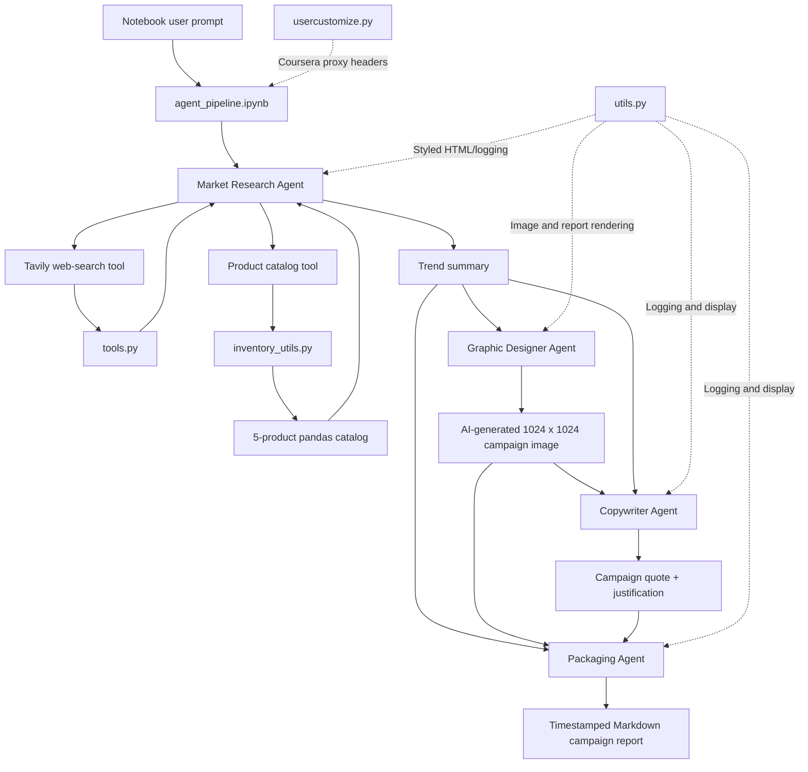

# AdCraft

AdCraft is an AI-assisted summer sunglasses campaign pipeline that combines live market research, an internal product catalog, AI-generated visuals, campaign copy, and a polished executive report. It coordinates four specialist agents in Jupyter Notebook to turn trend insights into a reusable marketing package.

## Tech stack

[](https://www.python.org/) 
[](https://jupyter.org/) 
[](https://platform.openai.com/) 
[](https://pandas.pydata.org/) 
[](https://python-pillow.org/) 
[](https://tavily.com/) 
[](https://github.com/andrewyng/aisuite)

## Project architecture



## Files and responsibilities

| File | Purpose | Connections |
|---|---|---|
| `agent_pipeline.ipynb` | Main executable notebook and system entry point. It initializes the AI client, runs tool checks, defines the four specialist agents, and exposes one helper to execute the complete campaign pipeline. | Imports `tools.py` and `utils.py`; uses `inventory_utils.py` indirectly through `tools.py`; writes `generated_image.png` and timestamped `campaign_summary_*.md` files. |
| `tools.py` | Provides the LLM-facing tool layer. It implements Tavily web search and catalog lookup, describes both tools for function calling, retries failed search calls up to 3 times, dispatches tool calls, and formats tool responses. | Calls `create_inventory_dataframe()` from `inventory_utils.py`; invoked by the Market Research Agent in `agent_pipeline.ipynb`. |
| `inventory_utils.py` | Creates a reproducible 5-item sunglasses catalog and supplies inventory/transaction/ledger helpers. It also contains stock checks, stock updates, plan execution, reflection prompting, and plan-response parsing. | Generates the DataFrame consumed by `tools.product_catalog_tool()` and supports inventory operations used by the notebook workflow. |
| `utils.py` | Supplies notebook presentation helpers and HTML rendering utilities. It formats tables, agent status cards, tool-call logs, tool results, final summaries, images, and pretty output cards. | Imported by `agent_pipeline.ipynb` and used throughout the agent functions for progress and result display. |
| `usercustomize.py` | Auto-loaded interpreter customization for Coursera/DLAI environments. It sets a proxy base URL/API placeholder and injects the hashed-user header into synchronous and asynchronous OpenAI HTTP clients. | Operates behind the scenes for every notebook client and OpenAI request; preserves explicitly supplied base URLs or HTTP clients. |
| `requirements.txt` | Pins the Jupyter, OpenAI, AI suite, pandas, image, HTTP, environment, and Tavily dependencies used by the project. | Environment setup for the notebook and local modules. |
| `generated_image.png` | Campaign artwork produced by the Graphic Designer Agent, used by the Copywriter and Packaging Agents. | Its path is passed to `copywriter_agent()` and embedded in the final Markdown report. |
| `campaign_summary_pipeline.md` | Executive summary produced by the pipeline. It documents the refined trends, product alignment, strategic rationale, and campaign visual. | Generated from `agent_pipeline.ipynb` outputs and image base64 embedding. |
| `campaign_summary_first.md` | Earlier/draft executive campaign summary and supporting visual. | Useful as a comparison or reference for the pipeline-generated report. |

## What is achieved

- **4 specialist agents** are coordinated: Market Research, Graphic Designer, Copywriter, and Packaging.
- **2 external/internal tool surfaces** are available to the research agent: Tavily search and the sunglasses product catalog.
- The catalog contains **5 product styles**—Aviator, Wayfarer, Mystique, Sport, and Round—each with a description, item ID, stock count, and price.
- The campaign logic identifies and promotes **3 matching hero products** in the saved executive summary: SG004 Sport, SG002 Wayfarer, and SG003 Mystique.
- The generated campaign visual is configured at **1024 × 1024 pixels**, and the final output is packaged as a **self-contained Markdown report** with an embedded image.
- Market search calls support **3 attempts** with progressive backoff, reducing transient Tavily failures.
- The project produces both intermediate outputs (trends, prompt, caption, quote, image) and a final markdown deliverable in a single pipeline run.

## Setup

```bash
pip install -r requirements.txt
jupyter notebook agent_pipeline.ipynb
```

Configure the required environment variables for your model/search providers, for example `OPENAI_API_KEY`, `TAVILY_API_KEY`, and, when using the Coursera/DLAI environment, `DLAI_OPENAI_BASE_URL`, `DLAI_TAVILY_BASE_URL`, and `COURSERA_HASHED_USER_ID`.

## Last words

Future improvements include persistent inventory storage, deterministic campaign output validation, richer campaign variants for multiple channels, automatic image-quality checks, downloadable social-media asset bundles, and evaluation metrics for relevance, brand consistency, and copy performance. Adding unit tests, notebook CI, and cost/latency tracking would also make AdCraft more production-ready.
